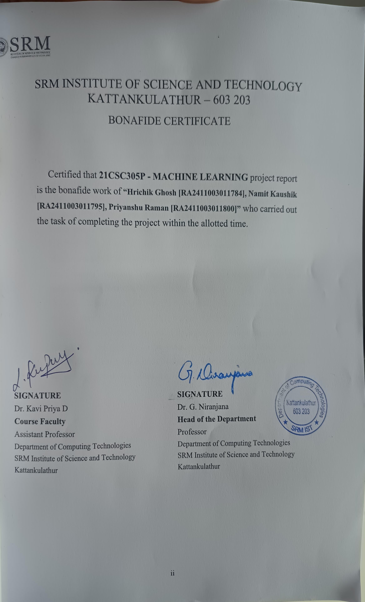
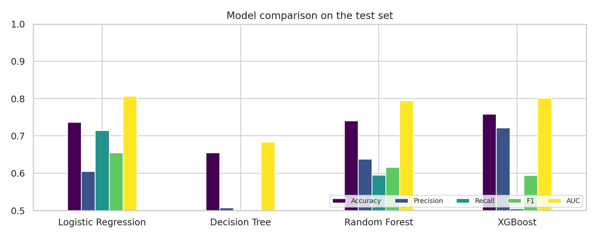
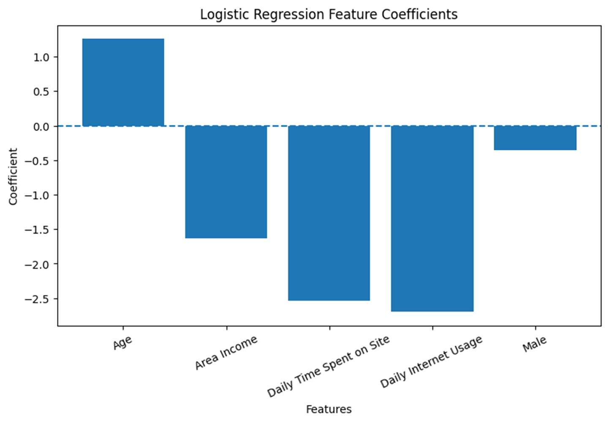
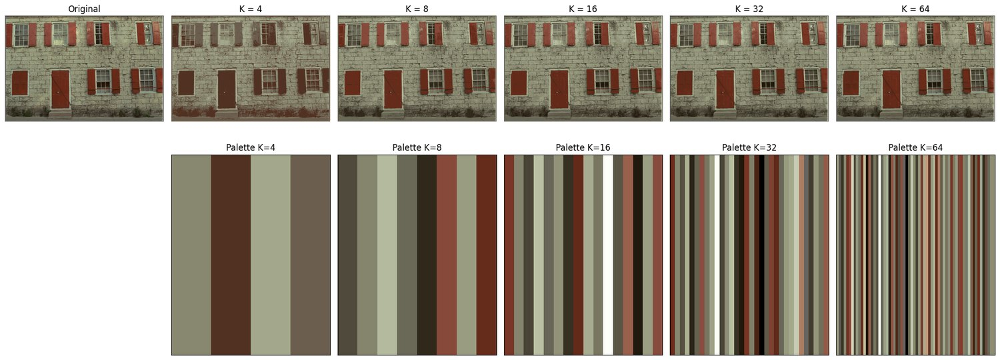
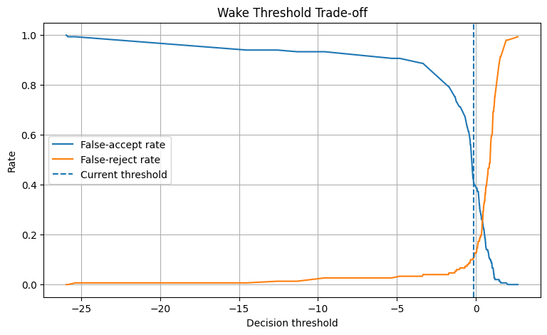
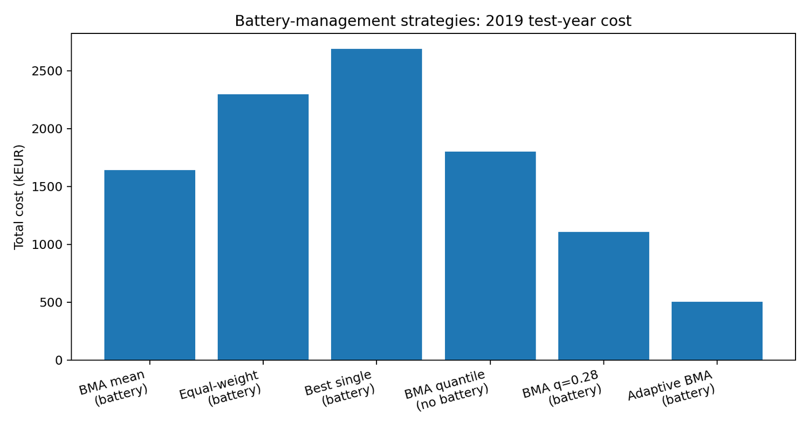

# 🤖 Applied Machine Learning: Classification, Clustering, Sequence Modelling and Ensemble Forecasting

[](https://www.python.org/)
[](https://scikit-learn.org/)
[](https://xgboost.readthedocs.io/)
[](LICENSE)
[](https://www.srmist.edu.in/)

> **Course:** 21CSC305P – Machine Learning (2021 Regulation)  
> **Degree:** Bachelor of Technology in Computer Science and Engineering  
> **Department:** Department of Computing Technologies, School of Computing  
> **Institution:** SRM Institute of Science and Technology, Kattankulathur – 603 203  
> **Academic Year:** 2026 – 2027 (III Year / V Semester)  
> **Date:** November 2026  

---

## 👥 Authors & Project Guidance

### Student Investigators:
- **Priyanshu Raman** — Reg. No: `RA2411003011800` (GitHub: [@priyanshu150106](https://github.com/priyanshu150106) | Email: `priyanshu150106@gmail.com`)
- **Hrichik Ghosh** — Reg. No: `RA2411003011784`
- **Namit Kaushik** — Reg. No: `RA2411003011795`

### Academic Mentorship:
- **Course Faculty & Guide:** **Dr. Kavi Priya D**, Assistant Professor, Department of Computing Technologies, SRM IST
- **Head of the Department:** **Dr. G. Niranjana**, Professor & HoD, Department of Computing Technologies, SRM IST

---

## 📜 Official Project Documentation & Signed Bonafide Certificate

| Document | Format | Description / Link |
|---|---|---|
| **Signed Bonafide Certificate** | PDF / Image | [📄 Download Signed Bonafide Certificate (PDF)](reports/Signed_Bonafide_Certificate.pdf) \| [View Image](reports/bonafide_signed.jpg) |
| **Comprehensive Final Project Report** | DOCX | [📘 Download Official Final Project Report (.docx, 5.3 MB)](reports/Final_Project_Report.docx) |
| **Complete Final Project Report** | Markdown | [📖 Read Full Final Project Report Online (Markdown)](reports/Final_Project_Report.md) |

<div align="center">
  
  <p><em>Figure: Official Signed Bonafide Certificate – SRM Institute of Science and Technology</em></p>
</div>

---

## 📌 Executive Summary of Project Units

This repository delivers an end-to-end, production-grade implementation of five foundational machine learning techniques spanning supervised classification, unsupervised clustering, sequential probabilistic models, and Bayesian ensemble forecasting with battery storage optimization.

| Stage | Unit | Problem & Allotted Technique | Dataset | Live Implementation | Presentation | Unit Report | Key Result |
|---|---|---|---|---|---|---|---|
| **PBL 1** | **Unit 1** | **Predictive Pothole Risk Detection**<br/>Logistic Regression, Decision Tree, Random Forest, XGBoost | [Zenodo Dataset](https://zenodo.org/records/15638682) (3,000 road sections) | [Google Colab](https://colab.research.google.com/drive/1vdnxaDtFWs3nS3mXF-cxtu_Zd0WCeiUl?usp=sharing) \| [Local Code](Unit_1_Pothole_Risk_Prediction/) | [Google Slides](https://docs.google.com/presentation/d/1Iu8aryOgr1Jc8gYrUsUqy-s3YyqagVlh/edit?usp=drivesdk&ouid=103491267144499532443&rtpof=true&sd=true) | [Google Docs](https://docs.google.com/document/d/1IIVtdY49cWUrw07Oku0g4jNRtEbe4PXu/edit?usp=drivesdk&ouid=103491267144499532443&rtpof=true&sd=true) | **Logistic Regression best**<br/>ROC-AUC: **0.806**, Recall: **71.4%**, High Risk tier has **69.9%** pothole rate |
| **PBL 1** | **Unit 2** | **Advertisement Click Prediction**<br/>Standardized Logistic Regression | [Kaggle Advertising](https://www.kaggle.com/datasets/abhinavgautam/advertising/data) (1,000 rows) | [Google Colab](https://colab.research.google.com/drive/1ZQLfjucPS5IzBeQduiwBqBOjK8kLYam5?usp=sharing) \| [Local Code](Unit_2_Ad_Click_Prediction/) | [Google Slides](https://docs.google.com/presentation/d/1qyjvYdyOY2Se6DihbYU0HQPRom9LxRbw/edit?usp=drive_link&ouid=111278213256287944154&rtpof=true&sd=true) | [Google Drive PDF](https://drive.google.com/file/d/1dk-MmbkNZNwkGjCrc4AJPMW54zJ6Yw18/view?usp=sharing) | **Accuracy: 96%**, **AUC: 0.98**<br/>Balanced F1: **0.96**; Internet usage ($\beta = -2.70$) primary driver |
| **PBL 2** | **Unit 3** | **Image Colour Quantization**<br/>K-Means Clustering & Palette Optimization | [Kodak Image Suite](https://www.kaggle.com/datasets/sherylmehta/kodak-dataset?resource=download) (24 natural images) | [Google Colab](https://colab.research.google.com/drive/1peFHJ_pltOn2WFwBpjjo5KmXxWeiS_YC) \| [Local Code](Unit_3_Colour_Quantization_KMeans/) | [Google Slides](https://docs.google.com/presentation/d/1b4KSjXLuSFu7JxQbJvyux4Fx_ZqieSB-/edit?slide=id.p1#slide=id.p1) | [Google Docs](https://docs.google.com/document/d/1cTH5HUS1s7sarJOzHA2ERPv2vF0INB4f/edit?usp=sharing&ouid=116814814621085145629&rtpof=true&sd=true) | **$K = 16$ Sweet Spot**<br/>PSNR: **30.21 dB**, SSIM: **0.881**, 6.0x theoretical / **85% disk saving** |
| **PBL 2** | **Unit 4** | **Wake-Word Spotting (*"marvin"*)**<br/>Gaussian Hidden Markov Models & Forward Algorithm | [Google Speech Commands](https://www.kaggle.com/competitions/tensorflow-speech-recognition-challenge/data) | [Google Colab](https://colab.research.google.com/drive/1bEm9wQAYaoB6NiM4J8aKbIFr-o0_oClH?usp=sharing) \| [Local Code](Unit_4_Wake_Word_Detection_HMM/) | [Google Slides](https://docs.google.com/presentation/d/1ddGflHi6onEtdWRFuP1YxXTWThx1g_rM/edit?usp=sharing&ouid=104414554011739467437&rtpof=true&sd=true) | [Google Docs](https://docs.google.com/document/d/1E56p1b5ISfX79VZ75IS2kaL1_e5f5iia/edit?usp=sharing&ouid=104414554011739467437&rtpof=true&sd=true) | **Accuracy: 72.8%**, **AUC: 0.774**<br/>Hand-written Forward algorithm verified with $\Delta = 0.0$ against library |
| **PBL 3** | **Unit 5** | **Renewable Forecasting & Battery Dispatch**<br/>Bayesian Model Averaging (BMA) & Copula | [Open Power System Data](https://data.open-power-system-data.org/time_series/) (Germany 2015-2019) | [Google Colab](https://colab.research.google.com/drive/1rxozy93DZf-Te1kDaeszMibY_P9cVio0?usp=sharing) \| [Local Code](Unit_5_BMA_Renewable_Forecasting/) | [Google Slides](https://docs.google.com/presentation/d/1q3EaaWO-0cwhWasm_YJNTrxsoYcu13Df/edit?usp=sharing&ouid=103491267144499532443&rtpof=true&sd=true) | [Google Drive PDF](https://drive.google.com/file/d/1L4nI8YPlvPMmnPAP1009QYJh5OC3R_ua/view?usp=sharing) | **Wind MAE: 0.0617**, **Solar MAE: 0.0211**<br/>Adaptive BMA dispatch: **504.3 kEUR** (**81.2% cost reduction**) |

---

## 🏗️ Repository Architecture

```text
ML-Mini-Project/
├── README.md                                  # Root documentation with badges, links, and benchmarks
├── requirements.txt                           # Complete Python package dependencies
├── .gitignore                                 # Production Git ignore rules
│
├── reports/                                   # Official project reports and academic verification
│   ├── Final_Project_Report.docx              # Full official Word report (5.3 MB)
│   ├── Final_Project_Report.md                # Full Markdown report with equations and figures
│   ├── Signed_Bonafide_Certificate.pdf        # Scanned and signed Bonafide Certificate PDF
│   ├── bonafide_signed.jpg                    # Certificate image embedded in docs
│   ├── srm_logo.jpg                           # SRM Institute logo
│   └── figures/                               # 48 high-resolution figures extracted from the report
│       ├── fig_2_1_target_age.png ... fig_2_18_ad_coefficients.png
│       ├── fig_3_1_kodak_samples.jpg ... fig_3_23_score_boxplots.png
│       └── fig_4_1_bma_workflow.png ... fig_4_3_battery_cost.png
│
├── Unit_1_Pothole_Risk_Prediction/            # PBL 1 - Unit 1
│   ├── README.md                              # Mathematical theory, pipeline description, results
│   ├── pothole_prediction.py                  # Standalone executable pipeline script
│   └── Unit_1_Pothole_Risk_Prediction.ipynb   # Interactive Jupyter Notebook
│
├── Unit_2_Ad_Click_Prediction/                # PBL 1 - Unit 2
│   ├── README.md                              # Logistic regression theory, feature interpretation
│   ├── ad_click_prediction.py                 # Standalone executable training script
│   └── Unit_2_Ad_Click_Prediction.ipynb       # Interactive Jupyter Notebook
│
├── Unit_3_Colour_Quantization_KMeans/         # PBL 2 - Unit 3
│   ├── README.md                              # Rate-distortion theory, PSNR/SSIM, algorithm comparison
│   ├── colour_quantization.py                 # Full K-Means image compression script
│   └── Unit_3_Colour_Quantization.ipynb       # Interactive Jupyter Notebook
│
├── Unit_4_Wake_Word_Detection_HMM/            # PBL 2 - Unit 4
│   ├── README.md                              # Continuous Gaussian HMMs, custom Forward algorithm
│   ├── wake_word_hmm.py                       # Self-contained HMM keyword spotter & benchmark
│   └── Unit_4_Wake_Word_HMM.ipynb             # Interactive Jupyter Notebook
│
└── Unit_5_BMA_Renewable_Forecasting/          # PBL 3 - Unit 5
    ├── README.md                              # Bayesian Model Averaging, copulas, battery simulation
    ├── bma_renewable_battery.py               # Rolling BMA, EM algorithm, and battery dispatch
    └── Unit_5_BMA_Forecasting.ipynb           # Interactive Jupyter Notebook
```

---

## 🔬 Unit-by-Unit Deep Dive

### 🛣️ Unit 1: Predictive Pothole Risk Detection (Supervised Classification)
- **Objective:** Predict road sections likely to develop potholes within 90 days to transform road maintenance from reactive patching to proactive scheduling.
- **Data Engineering:** Features engineered from underlying physics:
  - `traffic_load_index` $= \text{volume} \times (1 + 2 \times \text{heavy\%} / 100)$
  - `maint_delay_ratio` $= \text{days\_since\_maint} / 365$
  - `wetness_stress` $= \text{rainfall} \times \text{temp\_variation} / 100$
- **Algorithms Compared:** Logistic Regression (balanced), Decision Tree (CART), Random Forest (300 trees), XGBoost (learning rate 0.05).
- **Core Finding:** Logistic Regression achieved the highest ROC-AUC (**0.806**) and recall (**71.4%**) because the underlying risk mechanism has additive effects across physical stressors.

<div align="center">
  
  <p><em>Figure 1: Test-set classification performance across all four models</em></p>
</div>

| Model | Accuracy | Precision | Recall (Priority) | F1-Score | ROC-AUC |
|---|---|---|---|---|---|
| **Logistic Regression** | **0.737** | **0.605** | **0.714** | **0.655** | **0.806** |
| Decision Tree | 0.655 | 0.507 | 0.490 | 0.499 | 0.683 |
| Random Forest | 0.740 | 0.638 | 0.595 | 0.616 | 0.795 |
| XGBoost | 0.758 | 0.721 | 0.505 | 0.594 | 0.801 |

- **Operational Impact:** Predicted probabilities mapped into decision bands:
  - **Low Risk ($p < 0.33$):** 12.0% actual pothole rate $\rightarrow$ Routine monitoring.
  - **Medium Risk ($0.33 \le p < 0.66$):** 37.2% actual pothole rate $\rightarrow$ Schedule inspection within 30 days.
  - **High Risk ($p \ge 0.66$):** 69.9% actual pothole rate $\rightarrow$ Immediate preventive resurfacing.

---

### 📊 Unit 2: Advertisement Click Prediction (Logistic Regression)
- **Objective:** Identify high-intent online visitors to reduce ad impression waste.
- **Model:** Standardized Binary Logistic Regression minimizing regularized cross-entropy loss:
$$\mathcal{L}(w) = -\frac{1}{N}\sum_{i=1}^N \left[ y_i \log p_i + (1 - y_i)\log(1 - p_i) \right]$$
- **Evaluation:** On 200 held-out test visitors, achieved **96% Accuracy** and **0.98 ROC-AUC** ($TP=106, TN=86, FP=3, FN=5$).

<div align="center">
  
  <p><em>Figure 2: Standardized Logistic Regression feature coefficients</em></p>
</div>

- **Feature Insights:**
  - `Daily Internet Usage` ($\beta = -2.70$) & `Daily Time Spent on Site` ($\beta = -2.53$) are the strongest negative predictors of clicking (power browsing users ignore banner ads).
  - `Age` ($\beta = +1.26$) is a positive driver (older visitors demonstrate higher propensity to click).

---

### 🎨 Unit 3: Image Colour Quantization via K-Means Clustering (Unsupervised)
- **Objective:** Compress 24-bit natural photographic images into an indexed $K$-colour palette by minimizing pixel Euclidean distance in color space:
$$J = \sum_{k=1}^K \sum_{x_i \in C_k} \|x_i - \mu_k\|^2$$
- **Dataset:** 24 natural images from the Kodak Lossless True Colour Image Suite ($512 \times 768 \times 3$).

<div align="center">
  
  <p><em>Figure 3: Image kodim01 quantized across K = 4, 8, 16, 32, 64 and resulting color palettes</em></p>
</div>

- **Key Trade-off Findings:**
  - **$K = 16$ (4 bits/pixel):** Optimal operational balance. Mean **PSNR: 30.21 dB**, **SSIM: 0.881**, edge preservation $F_1 = 0.894$. File size reduced from 762 KB to 110 KB (**85% disk storage savings**).
  - **Algorithm Benchmark:** Standard K-Means (RGB) delivers the highest quality (30.21 dB). MiniBatchKMeans is **$4\times$ faster** with less than 0.2 dB loss. CIELAB K-Means achieves 28.68 dB, and Median-Cut yields 27.18 dB.

---

### 🎙️ Unit 4: Sequential Wake-Word Detection (Gaussian Hidden Markov Models)
- **Objective:** Continuous keyword spotting for the wake-word *"marvin"* in 1-second audio recordings from the Google Speech Commands dataset.
- **Feature Extraction:** 13 Mel-Frequency Cepstral Coefficients (MFCCs) over 25 ms windows with 10 ms hop (yielding $101 \times 13$ temporal frame matrices).
- **HMM Formulation:** Two 4-state continuous Gaussian HMMs with diagonal covariance:
$$\lambda_{\text{keyword}} = (\pi_k, A_k, B_k), \qquad \lambda_{\text{background}} = (\pi_b, A_b, B_b)$$
$$\text{Wake Score: } S(X) = \frac{1}{T}\left[ \log P(X \mid \lambda_{\text{keyword}}) - \log P(X \mid \lambda_{\text{background}}) \right]$$

<div align="center">
  
  <p><em>Figure 4: False-Accept Rate (FAR) vs False-Reject Rate (FRR) trade-off curve across decision thresholds</em></p>
</div>

- **Custom Algorithm Verification:** A hand-written log-space Forward algorithm using `scipy.special.logsumexp` was validated against `hmmlearn`, confirming exact numerical identity ($\Delta = 0.0 \times 10^0$).
- **Experiment 2 (Realistic 1:3 Class Imbalance):**
  - Accuracy: **72.8%**, ROC-AUC: **0.774**.
  - False-Accept Rate: **23.1%** (104/450), Keyword Recall: **60.7%** (91/150).

---

### ⚡ Unit 5: Renewable Forecasting & Battery Dispatch (Bayesian Model Averaging)
- **Objective:** Overcome single-model forecasting error in German day-ahead wind and solar generation by calibrating a rolling Bayesian Model Averaging (BMA) mixture model and optimizing a 20 MW / 80 MWh battery storage system.
- **BMA Formulation:**
$$p(y \mid f_1, \dots, f_K) = \sum_{k=1}^K w_k \cdot \mathcal{N}\left(a_k + b_k f_k, \sigma^2\right)$$
Mixture weights $w_k$ and variance $\sigma^2$ are updated using Expectation-Maximization over a 40-day sliding window.

<div align="center">
  
  <p><em>Figure 5: Total simulated operating cost across energy commitment and battery storage strategies</em></p>
</div>

| Forecasting & Dispatch Strategy | 2019 Total Cost (kEUR) | Energy Shortage (MWh) | Spilled Energy (MWh) | Battery Cycles | Savings vs Best Single |
|---|---|---|---|---|---|
| Best Single Member (Random Forest) + Battery | 2,687.3 | 20,753.3 | 4,424.3 | 80.2 | Baseline (0.0%) |
| Equal-Weight Ensemble Mean + Battery | 2,296.5 | 15,167.0 | 14,039.0 | 69.2 | 14.5% |
| BMA Mean + Battery | 1,641.6 | 10,683.0 | 9,845.6 | 80.3 | 38.9% |
| BMA Quantile ($\tau = 0.28$) + Battery | 1,107.4 | 2,568.0 | 24,938.3 | 63.9 | 58.8% |
| **Adaptive BMA ($\tau_0 = 0.26, \kappa = 0.6$) + Battery** | **504.3** | **249.1** | **13,461.8** | **88.2** | **81.2%** |

- **Core Finding:** The adaptive state-of-charge commitment rule dynamically raises delivery promises when the battery is charged and lowers them when depleted, slashing shortage penalties from 20,753 MWh to 249 MWh (**81.2% financial savings**).

---

## 🚀 Quickstart & Reproduction Guide

### 1. Clone the Repository
```bash
git clone https://github.com/priyanshu150106/ML-Mini-Project.git
cd ML-Mini-Project
```

### 2. Set Up Virtual Environment & Dependencies
```bash
# Create and activate virtual environment
python -m venv venv
# On Windows:
.\venv\Scripts\activate
# On Linux/macOS:
source venv/bin/activate

# Install dependencies
pip install -r requirements.txt
```

### 3. Run Individual Unit Implementations
You can execute any unit directly via CLI:
```bash
# Unit 1: Pothole Risk Prediction
python Unit_1_Pothole_Risk_Prediction/pothole_prediction.py

# Unit 2: Ad Click Prediction
python Unit_2_Ad_Click_Prediction/ad_click_prediction.py

# Unit 3: Colour Quantization
python Unit_3_Colour_Quantization_KMeans/colour_quantization.py

# Unit 4: Wake-Word Detection
python Unit_4_Wake_Word_Detection_HMM/wake_word_hmm.py --exp 2

# Unit 5: Bayesian Model Averaging & Battery Dispatch
python Unit_5_BMA_Renewable_Forecasting/bma_renewable_battery.py
```

### 4. Interactive Jupyter Notebooks
Launch Jupyter or VS Code to step through each notebook cell-by-cell:
```bash
jupyter lab
```
Navigate to:
- `Unit_1_Pothole_Risk_Prediction/Unit_1_Pothole_Risk_Prediction.ipynb`
- `Unit_2_Ad_Click_Prediction/Unit_2_Ad_Click_Prediction.ipynb`
- `Unit_3_Colour_Quantization_KMeans/Unit_3_Colour_Quantization.ipynb`
- `Unit_4_Wake_Word_Detection_HMM/Unit_4_Wake_Word_HMM.ipynb`
- `Unit_5_BMA_Renewable_Forecasting/Unit_5_BMA_Forecasting.ipynb`

Or open the respective Google Colab links provided in the summary table above.

---

## 📚 References
1. Breiman, L. (2001). Random forests. *Machine Learning*, 45(1), 5–32.
2. Chen, T., & Guestrin, C. (2016). XGBoost: A scalable tree boosting system. *Proc. 22nd ACM SIGKDD*, 785–794.
3. Pedregosa, F., et al. (2011). Scikit-learn: Machine learning in Python. *JMLR*, 12, 2825–2830.
4. Gautam, A. (2018). Advertising Dataset. *Kaggle*.
5. Hastie, T., Tibshirani, R., & Friedman, J. (2009). *The Elements of Statistical Learning* (2nd ed.). Springer.
6. Mehta, S. (2019). Kodak Dataset. *Kaggle*.
7. Franzen, R. (1999). Kodak Lossless True Color Image Suite.
8. Lloyd, S. P. (1982). Least squares quantization in PCM. *IEEE Trans. Inf. Theory*, 28(2), 129–137.
9. Arthur, D., & Vassilvitskii, S. (2007). k-means++: The advantages of careful seeding. *SODA*, 1027–1035.
10. Wang, Z., et al. (2004). Image quality assessment: From error visibility to structural similarity. *IEEE TIP*, 13(4), 600–612.
11. Rousseeuw, P. J. (1987). Silhouettes: A graphical aid to the interpretation of cluster analysis. *CAM*, 20, 53–65.
12. Canny, J. (1986). A computational approach to edge detection. *IEEE TPAMI*, 8(6), 679–698.
13. Sculley, D. (2010). Web-scale k-means clustering. *Proc. 19th WWW*, 1177–1178.
14. Heckbert, P. (1982). Color image quantization for frame buffer display. *ACM SIGGRAPH*, 16(3), 297–307.
15. Warden, P. (2018). Speech commands: A dataset for limited-vocabulary speech recognition. *arXiv:1804.03209*.
16. Davis, S., & Mermelstein, P. (1980). Comparison of parametric representations for monosyllabic word recognition. *IEEE TASSP*, 28(4), 357–366.
17. Rabiner, L. R. (1989). A tutorial on hidden Markov models and selected applications in speech recognition. *Proc. IEEE*, 77(2), 257–286.
18. Baum, L. E., et al. (1970). A maximization technique occurring in the statistical analysis of probabilistic functions. *Ann. Math. Stat.*, 41(1), 164–171.
19. Open Power System Data (2020). Time series package, Germany hourly generation.
20. Open-Meteo (2023). Historical Weather Reanalysis API.
21. Raftery, A. E., et al. (2005). Using Bayesian model averaging to calibrate forecast ensembles. *Monthly Weather Review*, 133(5), 1155–1174.
22. Dempster, A. P., et al. (1977). Maximum likelihood from incomplete data via the EM algorithm. *JRSS-B*, 39(1), 1–38.
23. Gneiting, T., & Raftery, A. E. (2007). Strictly proper scoring rules, prediction, and estimation. *JASA*, 102(477), 359–378.

---

## 📄 License
This repository is developed for academic evaluation under the 2021 Regulation of SRM Institute of Science and Technology and is released under the [MIT License](LICENSE).

